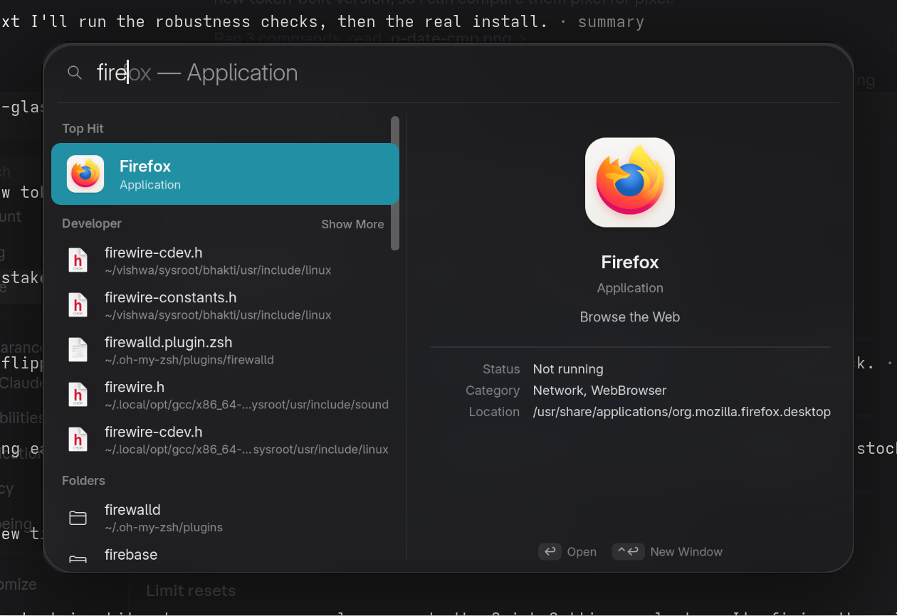

# Lucent

Small GNOME Shell extensions that make a glass desktop readable, quick and calm.
Each one does a single job, has a preferences window, and can be used on its own.

| Extension | What it does |
|---|---|
| **Lucent Launcher** | A keyboard launcher on a sheet of glass: apps, windows, files, calculator, unit and currency conversion, system toggles, timers, definitions, web shortcuts, your own commands. Ranked by what you actually pick. |
| **Lucent Glass** | Keeps glass readable. Menus, the calendar and notifications get a tint calculated to pass WCAG AA over any window; the top bar gets a light smoke so white text survives a bright wallpaper; Quick Settings and the calendar become glass panels in the manner of a phone's Control Centre: every control on its own card, the screen behind blurred and dimmed. Sits on top of [Blur my Shell](https://github.com/aunetx/blur-my-shell); works without it. |
| **Lucent Tiles** | Quiet live tiles for the top bar: CPU and memory (red only at a limit); what is going on now (a build's progress, a download, a long command, the song playing) with a player card on hover; tray icons tucked behind an arrow; and a short quote in place of the clock at login and wake. |
| **Lucent Dock** | Magnification for Dash to Dock: icons swell under the pointer and their neighbours make room. Everything else stays Dash to Dock's. |
| **Lucent Dissolve** | A closing window drifts away as fine mist (or retro pixels, or a soft blurred fade) instead of shrinking. |
| **Lucent Corner** | Rest the pointer in the top corner beside the system menu and Quick Settings opens. |



More pictures are in [docs/shots](docs/shots).

## Requirements

- GNOME Shell **51** (the only version these are tested on).
- `gjs` and `glib-compile-schemas` (both come with GNOME) and `python3` to build.

## Install

```sh
git clone https://github.com/Viswazgummadi/scripts.git ~/scripts
cd ~/scripts/lucent
./install.sh            # all six; or: ./install.sh launcher glass
```

Then log out and back in, and switch them on in the **Extensions** app. To remove them: `./install.sh --remove`.

Each release also has one zip per extension, installable with
`gnome-extensions install lucent-launcher@viswazgummadi.github.io.shell-extension.zip`.

## Using the launcher

Press **Super+Space** and type.

| Type | Get |
|---|---|
| `fire` | Firefox, with its actions; files and folders with that name |
| `12*7+3`, `15% of 80`, `sin 30`, `0x1f + 1` | the answer; Enter copies it |
| `5 km in miles`, `72f`, `$20 in eur` | the conversion |
| `today + 3 days`, `days until christmas`, `time in tokyo` | dates and times |
| `> make test` | run a command in a terminal (Ctrl+Enter: in the background) |
| `? gnome shell` | search the web |
| `kind:pdf report`, `pdfs from last week`, `notes in:Downloads ext:md` | filtered file search |
| `do not disturb`, `empty trash`, `timer 10 min` | system actions |

Tab completes the grey suggestion. Settings are in the extension's preferences; the tables (web
shortcuts, quick keys, projects) live in `~/.config/lucent-launcher/config.json`, which is reloaded
when you save it.

### What the launcher touches

- **Clipboard.** It keeps a history of what you copy (in memory only, unless you switch on saving) and
  can paste from it.
- **Commands.** It runs what you type after `>`, and nothing else.
- **Network.** A currency rate table from the European Central Bank when you convert money; a
  dictionary lookup when you ask for a definition; and, only if you switch it on, search suggestions.
- Every one of these can be switched off under *Privacy* and *Sources* in its preferences.

### What the tiles read

- `/proc`, for CPU, memory and temperature, and to notice running `ninja` builds, browser downloads
  in `~/Downloads` and long commands. For a build it also runs `ninja -n` (a dry run, which changes
  nothing) in that build's folder to know how many steps there are.
- Media players on the session bus (MPRIS), to show and control what plays.
- The sound output's level, through `parec`, only while the player card is open and music plays,
  for the visualiser. Nothing is recorded or kept.

## How it is built

- `design/tokens.json` is the only place a colour, radius or duration is written. The build turns
  each `stylesheet.in.css` into the real stylesheet, and fails if a pair of text and material falls
  below the contrast it promises. See [docs/DESIGN.md](docs/DESIGN.md).
- `make check` builds everything and runs every rule a release has to pass: metadata and schema
  validity, the GNOME Shell extension review rules that can be checked mechanically, a syntax check
  of every module, and the unit tests.
- `make pack` writes the release zips into `dist/`.
- `dev/probe` is a development-only extension that loads a build into the running shell, drives it
  and takes screenshots, so changes are tested without logging out.
  See [CONTRIBUTING.md](CONTRIBUTING.md).

## Limits, plainly

- Tested on one machine: Fedora 45, GNOME Shell 51, Wayland, Intel graphics, one monitor at 150 %.
- The launcher's terminal support is tested with Ptyxis only; GNOME Console, GNOME Terminal and
  xterm are wired up but untried. Any other terminal can be named in the settings file.
- Lucent Corner sits on the primary monitor. With another monitor beside that corner, the pointer
  is not stopped by the screen edge and the corner has to be aimed at.
- Lucent Glass decides dark or light per surface from the text the theme draws. With the stock light
  theme and Blur my Shell, the volume slider in Quick Settings is hard to see; that comes from the
  theme's own colours.
- Lucent Dock needs Dash to Dock (or Ubuntu Dock). The dock's background widens with the grown
  icons; a glass drawn by another extension follows it when that extension tracks the background's
  transformed size, as Blur my Shell does.
- User-visible text is English; the strings in the preferences are marked for translation, the ones
  in the shell are not yet.

## Licence

GPL-3.0-or-later. See [LICENSE](LICENSE).
